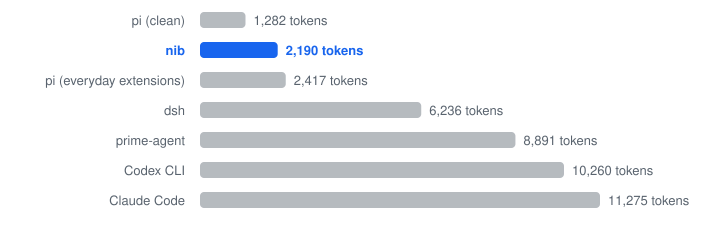
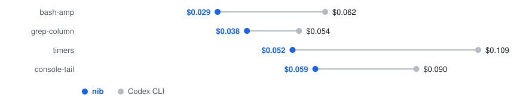

# 数据

## 资源占用

| Agent | 版本 | 安装大小 | 空闲 RSS | 10 个空闲实例总 RSS | 每次请求的固定提示 ≈tokens |
| --- | --- | ---: | ---: | ---: | ---: |
| nib | 0.5.0 (release, static) | 5 MB | 3.8 MB | 38 MB | 2.2k |
| pi (clean) | 1.4.0 | 108 MB + Node (121 MB) | 124 MB | 1,134 MB | 1.3k |
| pi (everyday extensions) | 1.4.0 | 620 MB + Node | 358 MB | 1,984 MB | 2.4k |
| Codex CLI | 0.166.0 | 305 MB | 275 MB | 1,164 MB | 10.3k |
| Claude Code | 2.1.319 | 324 MB | 174 MB | 1,750 MB | 11.3k |
| prime-agent | 0.10.2 | 63 MB + Python worker | 335 MB | 1,460 MB | 8.9k |
| dsh | dst TUI 0.16.1 | 141 MB + Node | 544 MB | 5,459 MB | 6.2k |

*2026 年 11 月本地测量，空闲 TUI，无模型请求；固定提示包含 system 和工具定义。*

### 每次请求的固定提示

<picture>
  <source media="(prefers-color-scheme: dark)" srcset="assets/bench-prompt-dark.svg">
  
</picture>

*2026 年 11 月，system + 工具定义，单位为 tokens。*

## 与 Codex CLI 对比

| 指标 | nib | Codex CLI | 差异 |
| --- | ---: | ---: | ---: |
| 墙钟时间（中位数） | 128 s | 144 s | 快 12% |
| 每任务费用（API 价格） | $0.044 | $0.079 | 低 44% |
| 模型请求（中位数） | 13 | 19 | 少 32% |
| 每任务输入 tokens | 192k | 623k | 少 69% |
| 任务通过 | 20/20 | 20/20 | — |

*2026 年 11 月，gpt-6.1-terra、medium，4 个任务各运行 5 次；nib 0.4 时期构建、codex-cli 0.166.0。*

### 每任务费用

| 任务 | nib | Codex CLI |
| --- | ---: | ---: |
| timers | $0.052 | $0.109 |
| bash-amp | $0.029 | $0.062 |
| grep-column | $0.038 | $0.054 |
| console-tail | $0.059 | $0.090 |

<picture>
  <source media="(prefers-color-scheme: dark)" srcset="assets/bench-cost-dark.svg">
  
</picture>

*同一组对比运行，美元，按 API 价格计算；各任务为接近中位数的均值。*

## 如何测量 / How measured

- 同一模型 gpt-6.1-terra、medium effort，4 个任务各运行 5 次，共 20 次。
- 记录墙钟时间、API 费用、模型请求、输入 tokens 和任务通过数。
- 安装大小与空闲 RSS 在本地测量；10 个实例的 RSS 为独立总量测量。
- 固定提示统计每次请求携带的 system 和工具定义。
- 数据源为 [benchmarks/data.json](benchmarks/data.json)；运行 `python3 scripts/charts.py` 重新生成六张深浅色 SVG。
